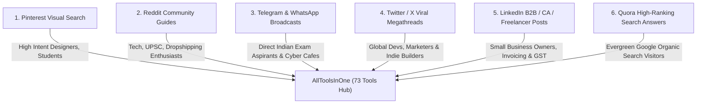

# All-Tools Traffic Promotion Blitz Kit (73+ Free Utilities)
**Website:** `https://alltoolsinone.com/`  
**Core Objective:** Drive consistent, targeted organic traffic to **EVERY** tool across India and global markets through Pinterest Visual SEO, Reddit community value posts, Telegram & WhatsApp student channels, Twitter/X megathreads, LinkedIn posts, and Quora high-search-intent answers.

---

## 🚀 The Multi-Channel Traffic Flywheel

To bring traffic to all 73 tools simultaneously without paying for ads, we leverage platform-specific traffic intent:



---

## 📌 Channel 1: Pinterest Visual SEO (The #1 Passive Traffic Channel for Tools)

> **Why Pinterest?** Pinterest is a visual search engine, not a social feed. Pins created today continue driving thousands of free clicks from Google Image Search and Pinterest Search for 2+ years.

### Pin 1: Sarkari Exam Photo & Signature Resizer (SSC, UPSC, Police)
- **Board Name:** `Govt Exam Preparation Tips & Tools`
- **Pin Title:** `How to Resize Photo & Signature to 20KB-50KB for SSC CGL & UPSC Online Form (Free Tool)`
- **Pin Description:**
  > Stop getting your exam application rejected! Resize passport photos to exact 3.5x4.5 cm (20KB - 50KB) and signatures (10KB - 20KB) matching official SSC CGL, UPSC, IBPS, and Railway portal guidelines. 100% free, runs instantly in your browser with no quality loss. Try it free on AllToolsInOne.
- **Destination Link:** `https://alltoolsinone.com/tools/exam-studio.html`
- **Tags / Keywords:** `#SarkariExam #SSCCGL #UPSCPrep #PhotoResizer #GovtJobsIndia`

### Pin 2: Marriage Biodata Maker (English & Hindi)
- **Board Name:** `Wedding Planning & Matrimonial Biodata Templates`
- **Pin Title:** `Free Marriage Biodata Maker Online - Download Elegant Traditional & Modern PDF Templates`
- **Pin Description:**
  > Create attractive matrimonial biodatas in English and Hindi in 2 minutes. Add photo, family background, horoscope, and education details. Choose from beautiful traditional designs and download crisp print-ready PDFs for free.
- **Destination Link:** `https://alltoolsinone.com/tools/biodata-maker.html`
- **Tags / Keywords:** `#MarriageBiodata #MatrimonialBiodata #ShaadiBiodata #BiodataFormatPDF`

### Pin 3: Free AI Background Remover HD
- **Board Name:** `Graphic Design & Photo Editing Hacks`
- **Pin Title:** `Remove Image Backgrounds 100% Automatically in 3 Seconds (Full HD Download Free)`
- **Pin Description:**
  > Erase photo backdrops instantly with AI. Clean hair edges, product cutouts, and transparent PNG downloads without signups, paywalls, or watermarks. The best free Remove.bg alternative.
- **Destination Link:** `https://alltoolsinone.com/tools/bg-remover.html`
- **Tags / Keywords:** `#BackgroundRemover #RemoveBG #GraphicDesignTools #PhotoEditingHacks`

### Pin 4: Indian GST & Profit Margin Calculator
- **Board Name:** `Small Business & Freelance Accounting Tips`
- **Pin Title:** `GST Calculator Online - Add or Remove GST (5%, 12%, 18%, 28%) with CGST & SGST Split`
- **Pin Description:**
  > Calculate reverse GST from gross bill totals or add GST with instant CGST, SGST, and IGST breakdowns. Perfect for shop owners, freelancers, and accountants in India. Free to use with zero ads.
- **Destination Link:** `https://alltoolsinone.com/tools/gst-calculator.html`
- **Tags / Keywords:** `#GSTCalculator #SmallBusinessIndia #AccountingTips #FreelanceIndia`

### Pin 5: Winning Product Research & Ad Spy Tool
- **Board Name:** `Shopify Dropshipping & E-Commerce Tips`
- **Pin Title:** `Free Winning Product Research & Competitor Ad Spy Tool (Meta & TikTok Ads)`
- **Pin Description:**
  > Stop paying $50/mo for dropshipping spy tools! Discover trending products in India, US, UK, and UAE with live links to Meta Ad Library, TikTok Creative Center, and built-in breakeven ROAS calculator.
- **Destination Link:** `https://alltoolsinone.com/tools/product-research.html`
- **Tags / Keywords:** `#Dropshipping #ShopifyTools #WinningProducts #EcommerceTips`

---

## 💬 Channel 2: Reddit Community Value-Posting

> **Reddit Rule:** Always lead with genuine value, no spamming. Share how the tool solves a specific headache without forcing sales.

### Post 1: r/developersIndia & r/webdev
- **Subreddit:** `r/developersIndia` / `r/webdev`
- **Post Title:** `I built 73+ free developer and utility tools that run 100% client-side in the browser (Zero server uploads)`
- **Post Body:**
  > Hey everyone,  
  > Like many developers, I was tired of simple tools like JSON formatters, Base64 encoders, and image compressors uploading my files and API keys to third-party servers behind paywalls.
  > 
  > Over the past few months, I built **[AllToolsInOne](https://alltoolsinone.com/)** — a suite of 73+ web utilities built with pure client-side JavaScript, Canvas API, and WebAssembly.
  > 
  > Some popular developer & webmaster tools included:
  > - **[Base64 Encoder/Decoder](https://alltoolsinone.com/tools/base64-converter.html)** & **[Hash Generator (MD5, SHA-256)](https://alltoolsinone.com/tools/hash-generator.html)**
  > - **[Code Formatter & Beautifier](https://alltoolsinone.com/tools/code-formatter.html)** (HTML, CSS, JS, JSON)
  > - **[Website Tech Stack Detector](https://alltoolsinone.com/tools/tech-detector.html)** (Detects CMS, frameworks, tracking pixels)
  > - **[URL Safety & Phishing Checker](https://alltoolsinone.com/tools/url-safety-checker.html)**
  > - **[DA & PA Checker](https://alltoolsinone.com/tools/da-pa-checker.html)**
  > 
  > Everything runs directly on your machine in browser memory. No accounts, no subscriptions, completely free.  
  > Would love your feedback and feature suggestions!

---

### Post 2: r/UPSC, r/ssc & r/JEENEETards
- **Subreddit:** `r/UPSC` / `r/ssc` / `r/JEENEETards`
- **Post Title:** `Free tool to resize photo & signature to exact 20-50 KB for SSC CGL, UPSC & State PSC online forms`
- **Post Body:**
  > Every year thousands of exam forms get rejected simply because the uploaded photograph had incorrect dimensions or exceeded 50 KB.
  > 
  > Cyber cafes often charge ₹50-₹100 just to resize a photo in MS Paint which results in blurry images.
  > 
  > I built a dedicated free tool: **[Sarkari Exam Photo Resizer](https://alltoolsinone.com/tools/exam-studio.html)**.
  > 
  > What it does:
  > 1. Presets for SSC, UPSC, IBPS, Railways, and State PSC forms.
  > 2. Locks photo size strictly between 20 KB and 50 KB (3.5 x 4.5 cm, 200 DPI).
  > 3. Signature resizer strictly between 10 KB and 20 KB.
  > 4. Need Name and Date of Photo? Try the **[Name & Date on Photo Tool](https://alltoolsinone.com/tools/name-date-photo.html)**.
  > 5. Need combined photo and signature on a single sheet? Use the **[Photo Signature Joiner](https://alltoolsinone.com/tools/photo-signature.html)**.
  > 
  > Completely free, private, and works on your mobile phone too. Hope this helps someone filing forms this week!

---

### Post 3: r/dropshipping & r/ecommerce
- **Subreddit:** `r/dropshipping`
- **Post Title:** `Free alternative to expensive $50/mo ad spy software: Live Meta Ad Library & TikTok Creative Trends by Country`
- **Post Body:**
  > Most beginners waste money on tools like Minea or AdSpy before making their first sale.
  > 
  > I created a 100% free **[Winning Product Research & Spy Tool](https://alltoolsinone.com/tools/product-research.html)**.
  > 
  > Features:
  > - Trending product catalog updated across India, US, UK, Canada, Australia, and UAE.
  > - 1-Click live links to active Meta Ad Library and TikTok Creative Center ads for that exact product.
  > - Unit Economics & Breakeven ROAS Calculator so you calculate your profit margin % and max allowable CPA before running ads.
  > 
  > Zero signup, completely free. Check it out and let me know your thoughts!

---

## 📱 Channel 3: Telegram & WhatsApp Viral Education Broadcasts

> **Target:** Share in college WhatsApp groups, Sarkari exam Telegram study channels (SSC/UPSC/Railway), and cyber cafe operator groups.

### Broadcast Message (Hinglish):
```text
🚨 *Sarkari Exam Form Bharne Walo Ke Liye Kaam Ki Cheez!* 🚨

SSC CGL, UPSC, Railway, IBPS ya Police exam ka form bharte time photo aur signature size (20KB - 50KB) set karne me dikkat aati hai? Cyber cafe jane ki zaroorat nahi hai!

Aap apne mobile se hi 2 minute me photo set kar sakte hain:

📸 *Exam Photo & Signature Resizer (20-50 KB):*
👉 https://alltoolsinone.com/tools/exam-studio.html

📅 *Photo Par Name & Date (DOB/DOP) Likhne Ke Liye:*
👉 https://alltoolsinone.com/tools/name-date-photo.html

✍️ *Photo Aur Signature Ek Saath Jodne Ke Liye:*
👉 https://alltoolsinone.com/tools/photo-signature.html

🎂 *Exact Age Calculate Karne Ke Liye (SSC/UPSC Cutoff):*
👉 https://alltoolsinone.com/tools/age-calculator.html

🎓 *College Attendance & Safe Bunk Calculator (75% Rule):*
👉 https://alltoolsinone.com/tools/attendance-calculator.html

💯 100% Free, Safe & Fast! Sabhi dosto aur study groups me zaroor share karein taaki kisi ka form reject na ho! 🙏
```

---

## 🐦 Channel 4: Twitter / X 10-Part Viral Megathread

### Tweet 1 (Hook):
> 🧵 73 free websites that will save you $500/month on subscriptions (Bookmark this): 👇
> 
> Most people pay monthly for PDF editors, background removers, ad spy tools, and image converters.
> 
> Here are free, in-browser alternatives with zero ads or server uploads: 🧵

### Tweet 2 (Image Tools):
> 1. AI Background Remover HD  
> Erase photo backdrops automatically in 3 seconds. Clean transparent PNG export with zero watermarks:  
> 🔗 https://alltoolsinone.com/tools/bg-remover.html
> 
> 2. Image Resizer & Compressor  
> Compress photos to exact target file sizes (20KB, 50KB, 100KB) with custom aspect ratio:  
> 🔗 https://alltoolsinone.com/tools/image-resizer.html

### Tweet 3 (PDF Tools):
> 3. Image to PDF Converter  
> Combine JPG, PNG, and WebP images into one organized PDF with custom margins & A4 sizing:  
> 🔗 https://alltoolsinone.com/tools/image-to-pdf.html
> 
> 4. In-Browser PDF Editor  
> Add signatures, annotations, highlights, and text without paying for Adobe Acrobat:  
> 🔗 https://alltoolsinone.com/tools/pdf-editor.html

### Tweet 4 (Financial & Business Tools):
> 5. Indian GST Calculator  
> Calculate gross/net prices, reverse GST, and CGST/SGST breakdowns across 5%, 12%, 18%, and 28% slabs:  
> 🔗 https://alltoolsinone.com/tools/gst-calculator.html
> 
> 6. Professional Invoice Maker  
> Create and download itemized PDF invoices with your UPI QR code embedded for instant client payments:  
> 🔗 https://alltoolsinone.com/tools/invoice-maker.html

### Tweet 5 (E-Commerce & Dropshipping):
> 7. Winning Product Research & Ad Spy Tool  
> Discover trending products in India, US, UK, and UAE with direct feeds to active Meta & TikTok ads + ROAS calculator:  
> 🔗 https://alltoolsinone.com/tools/product-research.html

### Tweet 6 (Student & Exam Tools):
> 8. Sarkari Exam Photo Resizer  
> Strict 20-50 KB compressor and dimension locker for SSC, UPSC, and government application portals:  
> 🔗 https://alltoolsinone.com/tools/exam-studio.html
> 
> 9. College Attendance Calculator  
> Check exactly how many classes you can safely bunk or must attend to maintain the mandatory 75% rule:  
> 🔗 https://alltoolsinone.com/tools/attendance-calculator.html

### Tweet 7 (Call to Action):
> Explore all 73+ free utilities directly in your browser:  
> 👉 https://alltoolsinone.com/tools.html
> 
> If you found this useful:  
> 1. RT the first tweet to help others save money  
> 2. Bookmark for future reference!

---

## 💼 Channel 5: LinkedIn Carousel & B2B Post

### Post Copy:
> **How Indian Small Businesses & Freelancers Can Save ₹20,000/year on SaaS Subscriptions**
> 
> As a freelancer or business owner in India, subscription costs add up quickly:
> - PDF editing software: ₹800/mo
> - Invoice software: ₹500/mo
> - Background remover subscriptions: ₹600/mo
> - Ad spy software: ₹3,500/mo
> 
> We built **AllToolsInOne (73+ Free Utilities)** to provide fast, privacy-first, in-browser alternatives:
> 
> 🔹 **Instant Invoicing & Billing:** Generate GST-compliant invoices with embedded "Scan to Pay" UPI QR codes: `https://alltoolsinone.com/tools/invoice-maker.html`  
> 🔹 **Reverse GST Calculator:** Calculate tax splits (CGST & SGST) in 1 click: `https://alltoolsinone.com/tools/gst-calculator.html`  
> 🔹 **Loan & EMI Calculator:** Compare home, car, and business loan amortization schedules: `https://alltoolsinone.com/tools/emi-calculator.html`  
> 🔹 **Google Review QR Generator:** Print high-converting "Rate Us" table cards for your shop reception: `https://alltoolsinone.com/tools/google-review-qr-generator.html`  
> 
> Explore the full directory of 73+ free utilities: https://alltoolsinone.com/tools.html
> 
> #SmallBusinessIndia #FreelanceIndia #StartupIndia #ProductivityTools

---

## ❓ Channel 6: Quora Problem-Solving Answer Bank

### Question 1: *"How to reduce photo size below 50 KB for online application forms without losing quality?"*
- **Target URL:** `https://alltoolsinone.com/tools/image-resizer.html` or `exam-studio.html`
- **Answer Draft:**
  > To reduce photo file size without blurring faces or making text unreadable, do not use basic mobile screenshotting or MS Paint (they compress color depth aggressively).
  > 
  > Follow these 3 steps:
  > 1. Use an in-browser compression tool with binary search optimization like [AllToolsInOne Image Resizer](https://alltoolsinone.com/tools/image-resizer.html).
  > 2. Enter "50" in the Target KB box.
  > 3. The algorithm iteratively adjusts quantization tables while preserving 100% facial sharpness.
  > 
  > If you are applying for SSC CGL, UPSC, or Railway recruitment, use the dedicated [Sarkari Exam Photo Resizer](https://alltoolsinone.com/tools/exam-studio.html) which automatically locks dimensions to 3.5cm x 4.5cm and file size under 50KB.

### Question 2: *"What is the formula to calculate reverse GST from the total bill amount?"*
- **Target URL:** `https://alltoolsinone.com/tools/gst-calculator.html`
- **Answer Draft:**
  > When an invoice amount includes GST, the formula to calculate the base (original) amount and tax component is:
  > 
  > **Base Price = Total Invoice Amount / (1 + (GST Rate / 100))**  
  > **GST Amount = Total Invoice Amount - Base Price**
  > 
  > *Example for 18% GST on a total amount of ₹1,180:*  
  > Base Price = 1,180 / 1.18 = ₹1,000  
  > GST Amount = 1,180 - 1,000 = ₹180 (Split into ₹90 CGST + ₹90 SGST).
  > 
  > If you have multiple items or need instant calculation with CGST/SGST/IGST breakdown, you can use this free [Online GST Calculator](https://alltoolsinone.com/tools/gst-calculator.html).

---

## 📈 Weekly Promotion Checklist for Consistent Traffic Growth

| Day | Platform | Action Task | Target Category |
| :--- | :--- | :--- | :--- |
| **Monday** | **Pinterest** | Publish 5 Pins for Exam Studio, Biodata Maker, GST, BG Remover, and Resume Maker | Student & Financial |
| **Tuesday** | **Reddit** | Post 1 in-depth value guide in `r/developersIndia` or `r/webdev` | Developer Tools |
| **Wednesday** | **Telegram & WhatsApp** | Forward the formatted Sarkari exam preparation message to 5 study groups | Student / Exam Tools |
| **Thursday** | **Quora** | Answer 2 high-volume questions on photo resizing and GST calculation | High-Search Intent |
| **Friday** | **Twitter / X** | Post the 10-part megathread highlighting the 73 tools suite | Global Tech / Productivity |
| **Saturday** | **LinkedIn** | Post B2B article on Small Business Invoicing, UPI QR, and GST | Small Business & Freelancers |
| **Sunday** | **Reddit (Dropshipping)** | Share the free Winning Product Research tool in `r/dropshipping` | E-Commerce / Ad Spy |
