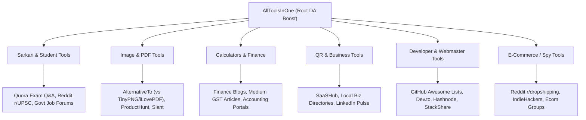
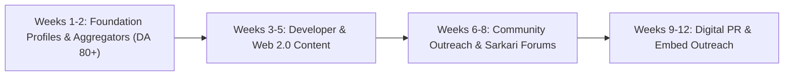

# Off-Page SEO & Backlink Building Master Plan (DA 70–98)
**Website:** `https://alltoolsinone.com/` (73+ Free Client-Side Utilities)  
**Target Goal:** Scale Domain Authority (DA) from 1 to 35+ in 90 days, and 50+ in 180 days via high-authority white-hat backlinks, directory listings, tool aggregators, web 2.0 syndication, and viral embed widgets.

---

## 1. Executive Strategy & Google Penalty Safeguards

To rank all 73 tools on Google (India & Global) without triggering Google Penguin or Spam Brain algorithmic penalties, backlink acquisition must adhere to strict natural link profile distributions:

### Natural Anchor Text Ratio (Strictly Enforced)
| Anchor Text Type | Target Ratio | Examples for AllToolsInOne | Risk Level if Exceeded |
| :--- | :--- | :--- | :--- |
| **Branded** | **40% – 50%** | `AllToolsInOne`, `AllTools`, `alltoolsinone.com` | Safe (Google expects brands to have branded anchors) |
| **Naked URL** | **20% – 25%** | `https://alltoolsinone.com/`, `alltoolsinone.com/tools/gst-calculator.html` | Completely natural |
| **Generic** | **15% – 20%** | `visit website`, `try free tool`, `check here`, `free online utility` | Blends seamlessly into natural discussions |
| **Partial Match / LSI** | **10% – 15%** | `free online age calculator`, `Sarkari exam photo resizer tool` | Boosts topical keyword relevance |
| **Exact Match** | **< 5%** | `gst calculator`, `image to pdf` | **DANGER**: >10% triggers Google manual/algorithmic penalty |

### Deep-Linking Distribution (No Homepage Clustering)
- **Homepage (`/`)**: ~35% of total incoming backlinks (Builds root domain trust).
- **Core Category Hubs (`/tools.html`)**: ~15% of backlinks.
- **Top 15 High-Volume Money Tools**: ~35% of backlinks (Distributed across GST, Age, Photo Resizer, Image to PDF, UPI QR, Product Research).
- **Long-Tail Utilities**: ~15% of backlinks (Developer tools, unit converters, formatters).

---

## 2. High DA Authority Platforms Directory (DA 70 – 98)

Below are the curated high-authority platforms categorized by link type, with domain metrics and direct submission targets.

### Category A: Tool Aggregators & Startup Directories (High Trust & Direct Referral Traffic)
| Platform | DA | Link Type | Ideal Tools to Submit | Direct URL / Submission Link |
| :--- | :---: | :---: | :--- | :--- |
| **Product Hunt** | 91 | Dofollow (Profile/Launch) | Full Suite / Product Research / Exam Studio | `https://www.producthunt.com/posts/new` |
| **AlternativeTo** | 81 | Dofollow / Referral | Image Converter, PDF Editor, BG Remover | `https://alternativeto.net/software/post/` |
| **SaaSHub** | 76 | Dofollow | AllToolsInOne Suite | `https://www.saashub.com/submit` |
| **BetaList** | 79 | Dofollow | Winning Product Research Tool | `https://betalist.com/submit` |
| **SourceForge** | 93 | Dofollow | Developer & PDF Tools Suite | `https://sourceforge.net/create/` |
| **ToolFinder** | 72 | Dofollow | AllToolsInOne Utilities | `https://toolfinder.co/submit` |
| **StartupStash** | 71 | Dofollow | Product Research & Invoice Maker | `https://startupstash.com/add-listing/` |
| **IndieHackers** | 84 | Dofollow (Product Page) | AllToolsInOne Product Page | `https://www.indiehackers.com/products/new` |
| **Slant.co** | 77 | Dofollow | Free PDF & Image Utilities | `https://www.slant.co/` |
| **Devpost** | 81 | Dofollow | Web & Browser Utilities Showcase | `https://devpost.com/software/new` |

---

### Category B: Developer, Tech & Web 2.0 Publishing (Contextual Backlinks DA 80–96)
| Platform | DA | Strategy | Target Tools | Direct URL |
| :--- | :---: | :--- | :--- | :--- |
| **GitHub** | 96 | Create an open-source repository `free-online-tools` with README directory + submit to curated `awesome-tools` lists | Developer, Webmaster & JSON Tools | `https://github.com/` |
| **Dev.to** | 87 | Publish technical guides: "10 Fast In-Browser Developer Utilities with Zero Server Uploads" | Base64, Hash, Code Formatter, JSON-XML | `https://dev.to/new` |
| **Hashnode** | 85 | Developer publication blog sharing client-side tool architecture | Tech Stack Detector, WHOIS, DA/PA Checker | `https://hashnode.com/` |
| **Medium** | 96 | Editorial articles: "The Complete Toolkit for Indian Freelancers and E-Commerce Dropshippers" | Invoice Maker, GST Calc, Product Research | `https://medium.com/new-story` |
| **LinkedIn Articles** | 98 | Business & GST guides: "How Small Business Owners Can Generate Instant UPI Billing QR Codes" | UPI QR Generator, Invoice Maker, GST Calc | `https://www.linkedin.com/post/new` |
| **GitLab** | 92 | Showcase repository with static mirrors and documentation | Developer Tools | `https://gitlab.com/` |

---

### Category C: High-Authority RSS & Web Feed Aggregators (Automated Backlinks)
*Our generated `feed.xml` and `rss.xml` can be submitted to these aggregators for instant indexing and recurring feed links:*
| Platform | DA | Feed Submission Target | URL |
| :--- | :---: | :--- | :--- |
| **Feedspot** | 82 | Add RSS Feed to Tech & Utility Tools Directory | `https://www.feedspot.com/fs/submitfeed` |
| **Feedly** | 92 | Public RSS Collection Indexing | `https://feedly.com/` |
| **Alltop** | 78 | Tech / Web Tools Category RSS Submission | `https://alltop.com/submission` |
| **Bloglovin** | 91 | Utility Blog Feed Claim | `https://www.bloglovin.com/` |
| **FeedBurner (Google)** | 93 | Google RSS Proxy & Distribution Feed | `https://feedburner.google.com/` |

---

### Category C2: Search Engines & Instant Indexing (Google & Microsoft Bing / Copilot)
*Microsoft's search engine (**Bing**) powers **Microsoft Copilot AI**, **Windows 10/11 Search**, **Yahoo**, and **DuckDuckGo**. Adding `alltoolsinone.com` here captures non-Google search traffic and AI summaries.*

| Search Engine / Protocol | Market Coverage | Implementation Setup | Action / Submission URL |
| :--- | :--- | :--- | :--- |
| **Microsoft Bing Webmaster Tools** | Bing, Copilot AI, Windows Taskbar, Yahoo | 1-Click Import from GSC or `BingSiteAuth.xml` / `<meta name="msvalidate.01">` | `https://www.bing.com/webmasters` |
| **IndexNow Protocol (Bing / Yandex)** | Instant crawler-less indexing for Microsoft Bing & partner engines | Automated script submitting all 75 URLs via key `c4b6e8a0f2d4e6189a0b2c4e6f8a0b2c.txt` | Run `node scratch/submit_to_bing_indexnow.js` |
| **Google Search Console** | Google Search & Discover | Sitemap `https://alltoolsinone.com/sitemap.xml` | `https://search.google.com/search-console` |

#### How to Add Website to Microsoft Bing in 1 Click:
1. Go to [Bing Webmaster Tools](https://www.bing.com/webmasters) and Sign In with your Google or Microsoft account.
2. Select **"Import your sites from Google Search Console"** and click **Import**.
3. Authorize your Google account: Bing will automatically import your verified domain, your sitemap (`https://alltoolsinone.com/sitemap.xml`), and all 75 URLs instantly without needing manual DNS or meta tag editing.
4. Once deployed to your live server, execute `node scratch/submit_to_bing_indexnow.js` to trigger instant IndexNow indexing directly to Microsoft Bing.

---

### Category D: Social Q&A & High-Karma Communities (Massive Referral Traffic)
| Community | DA | Target Sub-reddit / Topics | Strategy |
| :--- | :---: | :--- | :--- |
| **Reddit r/webdev** | 98 | Developer tools, offline privacy tools | Share how 100% in-browser client-side WebAssembly/JS tools protect privacy |
| **Reddit r/dropshipping** | 98 | Product research, TikTok/Meta ad spy | Share free alternative to expensive $50/mo ad spy software |
| **Reddit r/UPSC & r/ssc** | 98 | Sarkari photo signature resizer, age cutoff | Share exact SSC/UPSC dimensions & 20-50KB compressor tool |
| **Reddit r/IndiaSpeaks** | 98 | Free Indian utility software (UPI, GST, Biodata) | "I built 73+ free online tools for students & small businesses in India" |
| **Quora** | 93 | Questions on: "How to resize photo for SSC exam", "How to calculate GST reverse", "How to find winning dropshipping products" | Provide detailed, authoritative answers with contextual links |

---

## 3. Tool-Wise Deep Linking Matrix

To maximize keyword rankings across Google India & International, map each tool to its primary backlink niche:



---

## 4. Copy-Paste Ready Submission Kits (Pre-Formatted Content)

Use these exact copy-paste templates to submit right away:

### Kit 1: Product Hunt Submission
- **Product Name:** `AllToolsInOne`
- **Tagline:** `73+ Free Client-Side Online Utilities, PDF, Image & Exam Tools`
- **Primary Category:** `Productivity`, `Developer Tools`, `Design Tools`
- **Website URL:** `https://alltoolsinone.com/`
- **Short Description (260 chars):**
  > Free, privacy-first directory of 73+ web tools. Compress photos to exact KB, edit PDFs, calculate GST & EMI, generate dynamic UPI/Google Review QR codes, and spy on trending dropshipping products. Zero server uploads — 100% fast, client-side in your browser.
- **First Maker Comment:**
  > *Hey Product Hunt community! 👋 We got tired of tools full of ads, paywalls, and slow server uploads that steal your data. We built AllToolsInOne — a collection of 73+ essential utilities that run 100% in your browser. From passport photo resizing for Indian exams to PDF editing and live Meta Ad Library spying, everything is free forever. Would love your feedback!*

---

### Kit 2: AlternativeTo.net Submission
- **Name:** `AllToolsInOne`
- **URL:** `https://alltoolsinone.com/`
- **License:** `Free`
- **Platforms:** `Web / Browser`
- **Tagged as Alternative To:**
  - `iLovePDF` (Alternative: `https://alltoolsinone.com/tools/image-to-pdf.html`, `pdf-editor.html`)
  - `TinyPNG` (Alternative: `https://alltoolsinone.com/tools/image-resizer.html`)
  - `Remove.bg` (Alternative: `https://alltoolsinone.com/tools/bg-remover.html`)
  - `SmallSEOTools` (Alternative: `https://alltoolsinone.com/tools/word-counter.html`, `da-pa-checker.html`)
  - `QR Code Generator` (Alternative: `https://alltoolsinone.com/tools/qr-generator.html`, `upi-qr-generator.html`)
- **Description:**
  > AllToolsInOne is a free, modern web utility suite offering 73+ tools across PDF editing, image conversion, QR code creation, government exam photo resizing, financial calculators, and developer tools. All tools execute locally inside the browser with zero data harvesting.

---

### Kit 3: Dev.to / Hashnode Technical Article Draft
- **Title:** `Building 73+ Free In-Browser Tools with Zero Backend Storage (Architecture & Launch)`
- **Tags:** `#webdev #javascript #opensource #productivity`
- **Canonical URL:** `https://alltoolsinone.com/tools.html`
- **Body Content Snippet:**
  > While building web utilities, privacy is often neglected. Most PDF converters and background removers upload user files to remote servers.
  >
  > At [AllToolsInOne](https://alltoolsinone.com/), we designed a suite of 73+ tools using pure client-side JavaScript, Canvas API, and WebAssembly:
  > - **Client-Side Image Manipulation:** Using HTML5 Canvas and offscreen rendering for instant [Image Resizing to exact KB](https://alltoolsinone.com/tools/image-resizer.html) and [Background Removal](https://alltoolsinone.com/tools/bg-remover.html).
  > - **PDF Management:** Powered by PDF.js and pdf-lib directly in browser memory without sending private documents across the wire ([PDF Editor](https://alltoolsinone.com/tools/pdf-editor.html)).
  > - **Financial & Unit Calculations:** Instant mathematical engines for [GST Calculations](https://alltoolsinone.com/tools/gst-calculator.html) and [Loan EMI](https://alltoolsinone.com/tools/emi-calculator.html).
  > 
  > You can explore the complete suite of [73+ Free Online Tools](https://alltoolsinone.com/tools.html).

---

### Kit 4: Quora Question-Answer Blueprint (High India Search Intent)
- **Question 1:** *"How do I resize my photo and signature to 20KB-50KB for SSC CGL / UPSC online application?"*
  - **Answer Outline:** Explain the exact dimensions (3.5cm x 4.5cm, 200 DPI, 20-50 KB for photo, 10-20 KB for signature). Explain why paint and phone apps distort aspect ratios. Recommend:
    > "You can use this dedicated free [Sarkari Exam Photo Resizer](https://alltoolsinone.com/tools/exam-studio.html) which automatically matches SSC, UPSC, and IBPS portal rules and locks the file size exactly under 50KB without blur."
- **Question 2:** *"How do I calculate GST reverse amount from a total bill price?"*
  - **Answer Outline:** Provide the exact mathematical formula: `Base = Total / (1 + GST% / 100)`. Show an example for 18% GST on ₹1,180.
    > "If you want instant calculation with CGST/SGST breakdown, you can use this free [Online GST Calculator](https://alltoolsinone.com/tools/gst-calculator.html) which supports 5%, 12%, 18%, and 28% tax slabs."

---

### Kit 5: Reddit Community Value-First Posts
- **Subreddit:** `r/dropshipping`
- **Title:** `I built a free tool to spy on live Meta & TikTok ads + calculate breakeven ROAS (No $50/mo subscription)`
- **Body:**
  > Hey guys, most dropshipping spy tools (AdSpy, Minea) charge $50 to $100/month just to see what ads are scaling.
  > I built a completely free tool: [Winning Product Research & Spy Tool](https://alltoolsinone.com/tools/product-research.html).
  > Features:
  > - Curated winning products updated for India, US, UK, Canada, Australia & UAE.
  > - 1-Click live links to active Meta Ad Library and TikTok Creative Center feeds.
  > - Built-in Unit Economics & Breakeven ROAS calculator so you don't burn ad spend on negative-margin products.
  > Completely free to use. Feedback welcome!

---

## 5. Embeddable Backlink Widget Blueprint ("Viral Link Magnet")

By allowing other website owners, school portals, and finance blogs to embed calculators on their site, we gain continuous, high-authority organic backlinks.

### Sample Embed Code (Provided to External Webmasters):
```html
<!-- AllToolsInOne Free Embeddable GST Calculator Widget -->
<iframe src="https://alltoolsinone.com/tools/gst-calculator.html?embed=true" 
        width="100%" height="680" frameborder="0" style="border: 1px solid #e2e8f0; border-radius: 12px; max-width: 800px;">
</iframe>
<p style="font-size: 11px; color: #64748b; font-family: sans-serif; margin-top: 6px;">
  Powered by <a href="https://alltoolsinone.com/tools/gst-calculator.html" target="_blank" rel="noopener" style="color: #4f46e5; text-decoration: underline;">AllToolsInOne Free GST Calculator</a>
</p>
```

---

## 6. 90-Day Execution Roadmap & Daily Link-Building Sprint



### Sprint Schedule:
- **Week 1-2: Core Platform Submissions**
  - [ ] Submit to Product Hunt, AlternativeTo, SaaSHub, BetaList, SourceForge.
  - [ ] Submit `feed.xml` to Feedspot, Alltop, Feedly, and FeedBurner.
  - [ ] Create GitHub Showcase Repository with direct markdown links to all 73 tools.
- **Week 3-5: Web 2.0 & Authority Articles**
  - [ ] Publish 3 technical articles on Dev.to & Hashnode linking to Developer & PDF tools.
  - [ ] Publish 2 Medium articles on Indian student exam preparation and e-commerce tools.
  - [ ] Publish LinkedIn Pulse article on Business Invoicing and UPI QR codes.
- **Week 6-8: High-Intent Q&A & Community Value**
  - [ ] Answer 15 targeted Quora questions on exam photo sizing, GST calculations, and age calculation.
  - [ ] Share value posts on Reddit (r/webdev, r/dropshipping, r/UPSC).
- **Week 9-12: Blogger Outreach & Embed Link Building**
  - [ ] Email 25 Indian education blogs offering free embed widgets for student photo resizing.
  - [ ] Email 20 finance / CA blogs offering free embed widgets for the GST & Loan EMI calculator.
